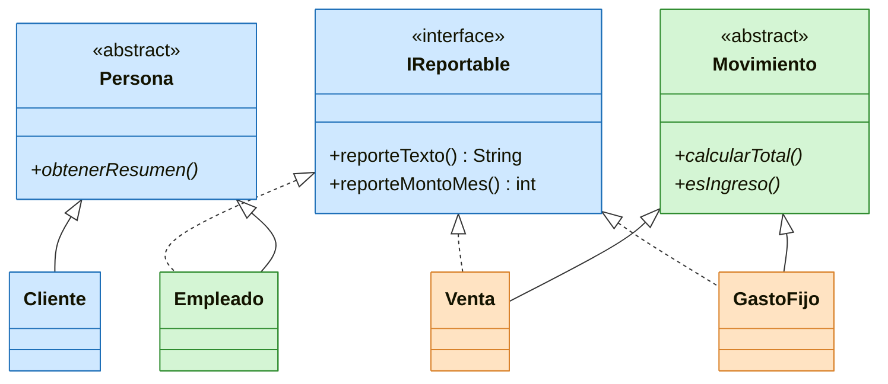
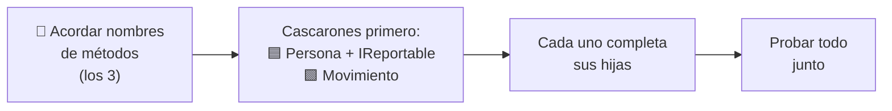
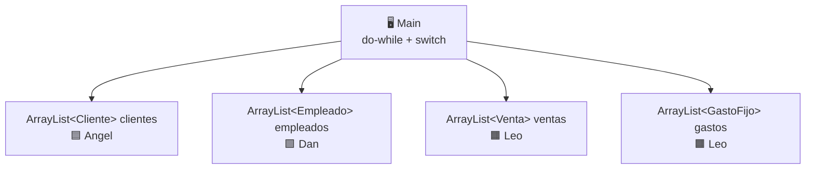

# 🐔 Laboratorio 9 - Reparto de los 7 archivos

Un negocio de venta de pollos necesita organizar su sistema de presupuesto y ventas diarias. El sistema anterior, basado en tablas de Excel, resultaba ineficiente y tedioso para el dueño. Para solucionar este problema, se desarrolló un programa en Java que registra de manera eficiente a los clientes (de Pucusana, Chilca y Mercado Chulis), las ventas del día, los gastos fijos (implementos, combustible, agua y gas) y el personal con sus respectivos pagos. Esto permite generar un presupuesto mensual claro y reemplazar el trabajo manual con una solución orientada a objetos.

**Clases Abstractas · POO Java · Tecsup**
👥 Grupo de 3 · 📂 Repositorio: `DDREMARC/ayllu-java-poo`

> ⚠️ **Rúbrica:** usar IA para resolver total o parcialmente el ejercicio resta **10 puntos**. Cada uno escribe y entiende su propio código.

---

## 🔢 Lo que pide el documento (mínimo)

| Tipo | Cantidad | Archivos |
|---|---|---|
| 🧬 Clases abstractas madre | **2** | `Persona.java`, `Movimiento.java` |
| 👶 Clases hijas | **4** | `Cliente.java`, `Empleado.java`, `Venta.java`, `GastoFijo.java` |
| 🔌 Interfaz | **1** | `IReportable.java` |

Las **4 hijas son el total del grupo**, no por persona.

---

## 🗺️ Cómo se relacionan

🟦 Angel · 🟩 Dan · 🟧 Leo

---

## 👥 Quién hace qué

| | 🟦 **Angel** | 🟩 **Dan** | 🟧 **Leo** |
|---|---|---|---|
| **Madre abstracta** | `Persona.java` | `Movimiento.java` | - |
| **Hijas** | `Cliente.java` | `Empleado.java` | `Venta.java`, `GastoFijo.java` |
| **Interfaz** | `IReportable.java` | - | - |
| **Total de archivos** | **3** | **2** | **2** |

---

## 🟦 Angel

### 🧬 `Persona.java` (abstracta)
- [x] Atributos privados: `documento`, `nombre`, `telefono` ✅ 2026-10-17
- [ ] Constructor que recibe los tres datos
- [ ] Getters y setters con validación (no vacíos)
- [ ] El documento no tiene setter (es la identidad)
- [ ] Un método normal que muestra los datos
- [ ] Un método **abstracto** `obtenerResumen()` que devuelve un resumen (las hijas lo implementan)

### 👤 `Cliente.java` (hija de `Persona`)
- [ ] Atributos propios: `zona` (Pucusana, Chilca o Mercado Chulis) y `deudaTotal`
- [ ] Constructor que llama a `super(...)` y empieza con deuda 0
- [ ] Método para **aumentar** la deuda (monto mayor que 0)
- [ ] Método para **reducir** la deuda (nunca queda negativa)
- [ ] Método que dice si tiene deuda
- [ ] Implementa `obtenerResumen()` con `@Override`
- [ ] Parte de clientes del menú en el `Main` (la hace Angel)

### 🔌 `IReportable.java` (interfaz)
- [ ] `String reporteTexto()` → devuelve un reporte en texto
- [ ] `int reporteMontoMes()` → devuelve el monto del mes
- [ ] Nombre con **I mayúscula**: `IReportable`
- [ ] Acordar con los otros dos los nombres exactos antes de escribirla

---

## 🟩 Dan

### 🧬 `Movimiento.java` (abstracta)
- [x] Atributos privados: `id`, `fecha`, `descripcion` ✅ 2026-10-17
- [x] Constructor que recibe los tres datos ✅ 2026-10-17
- [x] Getters y setters con validación ✅ 2026-10-17
- [x] Un método normal que muestra el movimiento (`mostrarInfo()`) ✅ 2026-10-17
- [x] Un método **abstracto** `calcularTotal()` ✅ 2026-10-17
- [x] Un método **abstracto** `esIngreso()` que dice si es ingreso o no ✅ 2026-10-17

### 👷 `Empleado.java` (hija de `Persona`, implementa `IReportable`)
- [ ] `extends Persona implements IReportable`
- [ ] Atributos propios privados: `cargo`, `pagoPorDia`, `diasTrabajados`, `bono`
- [ ] Constructor que llama a `super(...)`
- [ ] Getters y setters
- [ ] Método para registrar días (mayor que 0)
- [ ] Método para asignar bono (no negativo)
- [ ] Método que calcula el pago: días × pago por día + bono
- [ ] `@Override` en `obtenerResumen()` (abstracto en `Persona`, **obligatorio**)
- [ ] `@Override` en `String reporteTexto()`
- [ ] `@Override` en `int reporteMontoMes()`

---

## 🟧 Leo

### 🛒 `Venta.java` (hija de `Movimiento`, implementa `IReportable`)
- [ ] `extends Movimiento implements IReportable`
- [ ] Atributos propios privados: `cliente`, `pesoKg`, `precioKg`, `montoPagado`
- [ ] Constructor que llama a `super(...)`
- [ ] Getters y setters
- [ ] Total = peso × precio (`calcularTotal()` con `@Override`)
- [ ] Deuda = total − pagado
- [ ] `esIngreso()` con `@Override`: dice que **sí** es ingreso
- [ ] Setters con validación (peso y precio mayores que 0, pagado no mayor al total)
- [ ] Cuando cambia el peso o el precio, **corrige la deuda del cliente**
- [ ] `@Override` en `String reporteTexto()`
- [ ] `@Override` en `int reporteMontoMes()`

### 🔧 `GastoFijo.java` (hija de `Movimiento`, implementa `IReportable`)
- [ ] `extends Movimiento implements IReportable`
- [ ] Atributos propios privados: `tipo` (implementos, combustible y peajes, agua y gas, otros) y `monto`
- [ ] Constructor que llama a `super(...)`
- [ ] Getters y setters
- [ ] Total = el monto (`calcularTotal()` con `@Override`)
- [ ] `esIngreso()` con `@Override`: dice que **no** es ingreso
- [ ] Validar que el tipo sea uno de la lista
- [ ] `@Override` en `String reporteTexto()`
- [ ] `@Override` en `int reporteMontoMes()`

---

## ⚠️ Orden de trabajo (para que no se bloqueen)

| Quién | Necesita de otro |
|---|---|
| 🟦 Angel | Nada para empezar |
| 🟩 Dan | `Persona` e `IReportable` de Angel (para `Empleado`) |
| 🟧 Leo | `Cliente` e `IReportable` de Angel, `Movimiento` de Dan |

---

## 🔒 Lo que el laboratorio exige en TODOS los archivos

- [ ] Atributos `private`
- [ ] Constructor
- [ ] Getters y setters (con validación para no dejar objetos inconsistentes)
- [ ] Las madres tienen métodos abstractos y métodos normales
- [ ] Las hijas implementan o sobrescriben los métodos de la madre
- [ ] `@Override` en todo método heredado o implementado
- [ ] Las hijas llaman a `super(...)` en el constructor
- [ ] Atributos del padre se leen **siempre con getters** (`getNombre()`, etc.), nunca directo
- [ ] Nada de código repetido entre clases parecidas
- [ ] Sin `if`, `switch` ni `instanceof` para decidir el tipo de un objeto

---

## 🖥️ Main (los 3 juntos, al final)

- [ ] Un `ArrayList` por cada clase hija (los 4 de arriba)
- [ ] Menú con `Scanner`, `do-while` y `switch` (solo para elegir la opción del menú, no el tipo de objeto)
- [ ] Opciones: registrar, buscar, modificar, eliminar
- [ ] Parte de clientes: 🟦 Angel
- [ ] Parte de empleados: 🟩 Dan
- [ ] Parte de ventas y gastos: 🟧 Leo

---

## 📦 Lo que falta del laboratorio (por repartir después)

Estos puntos no están en los 7 archivos, pero el documento los pide:

| Pendiente | Propuesta |
|---|---|
| 🖥️ Menú con `Scanner` y clase `Main` (registrar, buscar, modificar, eliminar) | Los 3 juntos |
| 📝 Descripción del problema (incluye por qué se usó la interfaz) | 🟦 Angel |
| 📐 Diagrama UML | 🟩 Dan |
| 📄 Un solo archivo de texto con todo el código | 🟦 Angel |
| 🧾 3 conclusiones | Una cada uno |

---

## ❓ Por confirmar entre los 3 (las dos fuentes no coinciden)

| Tema | `reparto` decía | `tarea` decía | Quedó en este archivo |
|---|---|---|---|
| Nombre de la interfaz | `Reportable` | `IReportable` | `IReportable` ⚠️ |
| Constructor de `Persona` | `documento, nombre, telefono` | `nombre, numeroTelefono, codigoPersona` | Sin fijar: **acordar orden y nombres** |
| Método normal de `Movimiento` | "mostrar" | `mostrarInfo()` | `mostrarInfo()`, marcado hecho |
| Atributos de `Movimiento` | `id, fecha, descripcion` | "fecha, monto o similar" | `id, fecha, descripcion` |
| Atributos de `Empleado` | `cargo, pagoPorDia, diasTrabajados, bono` | "cargo, sueldo" | Los de `reparto` |
| Atributos de `Venta` | `cliente, pesoKg, precioKg, montoPagado` | "cantidadPollos, precioUnitario" | Los de `reparto` |
| Atributos de `GastoFijo` | `tipo, monto` | "descripcion, montoFijo" | Los de `reparto` |
| Tipo de `reporteMontoMes()` | "devuelve el monto del mes" | `int` | `int` ⚠️ (pero `pesoKg × precioKg` y el pago de `Empleado` pueden dar decimales: ¿`int` o `double`?) |
