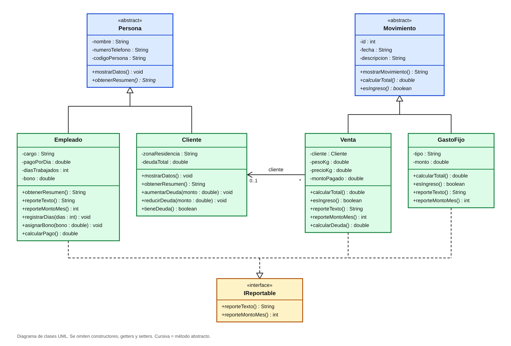

# 🐔 Laboratorio 9 — Clases Abstractas

**POO en Java · Tecsup · Docente: Nilton Mercado**
Grupo: 🟦 Angel · 🟩 Dan · 🟧 Leo

---

## 📝 Descripción del problema

Nuestro negocio es la venta de pollos, y hoy el control de clientes, empleados, ventas y gastos se lleva de forma desordenada, por lo que es difícil saber cuánto se gana realmente. Para resolverlo proponemos un sistema que guarde todo en un solo lugar y calcule la ganancia automáticamente.

Creamos la clase abstracta `Persona`, que guarda el código, el nombre y el teléfono. De ella salen `Cliente` y `Empleado`, porque los dos son personas y comparten esos tres datos, así que no hace falta repetirlos. El `Cliente` guarda además su zona de residencia y la deuda que tiene, y el `Empleado` sus días trabajados, el pago por día, los bonos y su cargo. `Persona` los obliga a implementar el método `obtenerResumen()`, que cada uno resuelve a su manera: el cliente muestra su zona y su deuda, y el empleado su cargo.

La otra clase madre es `Movimiento`, que guarda el ID, la fecha y la descripción. De ella salen `Venta` y `GastoFijo`, porque los dos son movimientos de dinero del negocio y comparten esos tres datos. `Movimiento` los obliga a implementar dos métodos: `calcularTotal()`, donde la venta se calcula por kilo y el gasto usa su monto fijo, y `esIngreso()`, que responde si el dinero entra: en la venta dice que sí y en el gasto dice que no. `Venta` guarda el cliente, el peso, el precio por kilo y el monto pagado, y su total es el peso por el precio. `GastoFijo` guarda el tipo y el monto, con los tipos implementos, combustible y peajes, agua y gas, y otros.

También creamos la interfaz `IReportable`, que usan `Empleado`, `Venta` y `GastoFijo`. No son parientes entre sí, pero las tres tienen que entregar un texto y un monto para el informe, y por eso es una interfaz y no otra clase madre.

Por último, `GestorNegocio` guarda las listas de clientes, empleados, ventas y gastos. Valida que no falten datos, que no se repita el código de un cliente o empleado y que el monto pagado no pase del total. Permite registrar, mostrar y eliminar en todas las listas, además de buscar clientes y modificar ventas y gastos. El reporte final muestra los ingresos por ventas, los gastos fijos, el pago al personal y la ganancia.

---

## 📐 Diseño de clases



| Tipo | Clases |
|---|---|
| 🧬 Clases abstractas madre | `Persona`, `Movimiento` |
| 👶 Clases hijas | `Cliente`, `Empleado`, `Venta`, `GastoFijo` |
| 🔌 Interfaz | `IReportable` |
| ⚙️ Gestión y menú | `GestorNegocio`, `ConsolaMain` |

---

## ▶️ Cómo ejecutarlo

```bash
javac *.java
java ConsolaMain
```

El menú tiene 17 opciones más la de salir: registrar, mostrar, buscar, modificar y eliminar clientes, empleados, ventas y gastos, ver personas y movimientos por polimorfismo, y ver los reportes.

---

## 📦 Archivos de entrega

Están en la carpeta **`entrega/`**. Es lo único que se le envía al profesor.

| Archivo | Qué es |
|---|---|
| `entrega/Lab9-ClasesAbstractas-ENTREGA.txt` | Descripción del problema + código fuente completo |
| `entrega/UML-Lab9.png` | Diagrama de clases UML |

Los archivos `*.java` de la raíz son el programa en sí, para trabajarlo y ejecutarlo.

---

## 👥 Reparto del trabajo

| | 🟦 Angel | 🟩 Dan | 🟧 Leo |
|---|---|---|---|
| Clase madre | `Persona` | `Movimiento` | — |
| Hijas | `Cliente` | `Empleado` | `Venta`, `GastoFijo` |
| Interfaz | `IReportable` | — | — |

> ⚠️ **Rúbrica:** usar IA para resolver total o parcialmente el ejercicio resta **10 puntos**. Cada uno escribe y entiende su propio código.
