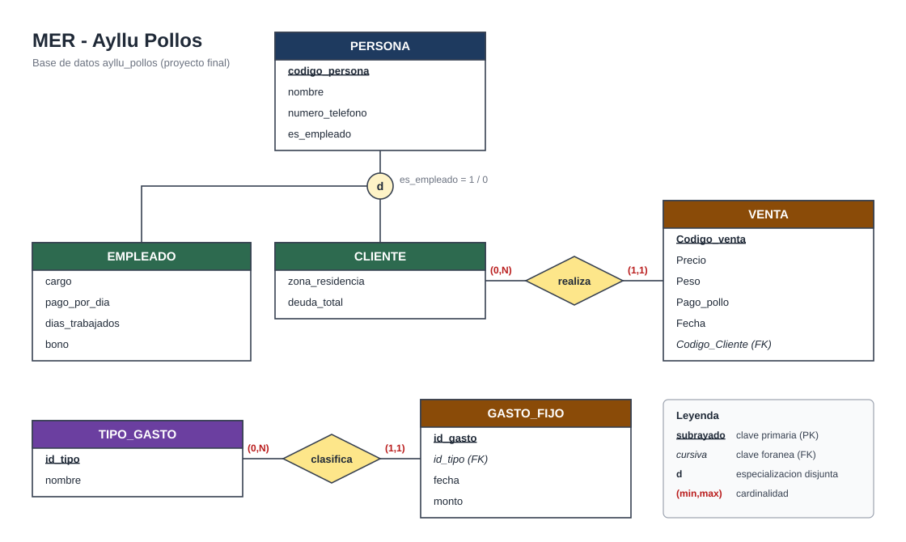

# 🐔 Proyecto Final — Ayllu Pollos (POO Java + JDBC)

**POO en Java · Tecsup · Docente: Nilton Mercado**
Grupo: 🟦 Angel · 🟩 Dan · 🟧 Leo

Este proyecto une lo trabajado en los laboratorios 9, 10 y 11 en un solo sistema:

| Laboratorio | Qué aportó al proyecto final |
|---|---|
| **Lab 9** — Clases abstractas e interfaces | Las clases `Persona` → `Cliente`/`Empleado`, `Movimiento` → `Venta`/`GastoFijo` y la interfaz `IReportable`. |
| **Lab 10** — JDBC con `Statement` | La base de datos `ayllu_pollos`, las tablas y el CRUD completo de cada una por consola. |
| **Lab 11** — `PreparedStatement` + MVC | La estructura Modelo / Controlador / Vista, la clase `DatabaseConnector` y las consultas con `?`. |

## 📝 Descripción del problema

Nuestro negocio es la venta de pollos. El control de clientes, empleados, ventas y gastos se llevaba
de forma desordenada y no se sabía cuánto se ganaba realmente. El sistema guarda todo en MySQL,
permite administrar cada entidad y calcula la ganancia automáticamente separando lo **cobrado** de
lo **pendiente** (una venta al crédito no es plata en caja).

## 🗂️ Estructura (MVC)

```
proyecto-final/
├── sql/script_ayllu_pollos.sql     # CREATE DATABASE + tablas + datos iniciales
└── src/
    ├── ProyectoFinalMain.java      # Solo arranca la vista
    ├── conexion/DatabaseConnector.java
    ├── modelo/                     # Representan las filas de las tablas (Lab 9)
    │   ├── Persona (abstracta) → Cliente, Empleado
    │   ├── Movimiento (abstracta) → Venta, GastoFijo
    │   ├── TipoGasto
    │   └── IReportable (interfaz)
    ├── controlador/                # Ejecutan el SQL con PreparedStatement y devuelven datos
    │   ├── PersonaController, VentaController, GastoFijoController
    │   └── ReporteController       # Ganancia y planilla usando polimorfismo
    └── vista/
        ├── MainView.java           # Menú principal: abre la conexión y reparte a cada vista
        ├── VistaBase (abstracta)   # Lo común a toda vista: lector, mostrarResultado, formatoMonto
        ├── PersonaView, VentaView, GastoFijoView, ReporteView
        └── Lector.java             # Lecturas seguras (no se rompe si escriben letras)
```

- El **modelo** solo guarda datos y sabe calcular lo suyo (`calcularTotal()`, `esIngreso()`, `calcularPago()`).
- El **controlador** es el único que habla con la base de datos. No imprime nada: devuelve listas, objetos o filas afectadas.
- La **vista** es la única que muestra menús y mensajes. Si el controlador devuelve 0 filas, la vista dice "No se realizó ningún cambio".

## 🗄️ Base de datos



| Tabla | Clave primaria | Campos |
|---|---|---|
| `personas` | `codigo_persona VARCHAR(20)` | nombre, numero_telefono, es_empleado (1/0), zona_residencia, deuda_total, cargo, pago_por_dia, dias_trabajados, bono |
| `tipo_gasto` | `id_tipo INT` | nombre |
| `gasto_fijo` | `id_gasto INT AUTO_INCREMENT` | id_tipo (FK → tipo_gasto), fecha, monto |
| `ventas` | `Codigo_venta INT AUTO_INCREMENT` | Precio, Peso, Pago_pollo, Fecha, Codigo_Cliente (FK → personas) |

Correcciones respecto al Lab 10 (observaciones del profesor):
- El script empieza con `CREATE DATABASE` y `USE`.
- Todos los montos son `DECIMAL(10,2)` (antes había `FLOAT`).
- `Codigo_Cliente` es `VARCHAR(20)` igual que `codigo_persona` y tiene `FOREIGN KEY`.
- La fecha por defecto usa `DEFAULT (CURRENT_DATE)` con paréntesis (funciona en MySQL y MariaDB).
- Hay datos iniciales en las 4 tablas y solo se usan códigos de cliente que existen.

## ⚖️ ¿`Statement` o `PreparedStatement`? Elegimos `PreparedStatement`

En el Lab 10 usamos `Statement` armando el SQL con concatenación:

```java
String sql = "SELECT * FROM ventas WHERE Codigo_venta = " + codigo;   // Lab 10
Statement st = conexion.createStatement();
ResultSet rs = st.executeQuery(sql);
```

En el proyecto final todo el acceso a datos usa `PreparedStatement`:

```java
String sql = "SELECT * FROM ventas WHERE Codigo_venta = ?";           // Proyecto final
PreparedStatement ps = connection.prepareStatement(sql);
ps.setInt(1, codigo);
ResultSet rs = ps.executeQuery();
```

| Criterio | `Statement` | `PreparedStatement` |
|---|---|---|
| **Seguridad** | El valor va pegado al SQL. Si el usuario escribe `' OR '1'='1` entra como código SQL (inyección). | El valor viaja aparte del SQL. El motor lo trata siempre como dato, nunca como código. |
| **Comillas y tipos** | Hay que poner `'` a mano en los textos y cuidar el formato de fechas y decimales. | `setString`, `setInt`, `setDouble` se encargan del tipo y de las comillas. |
| **Errores de sintaxis** | Fáciles de cometer al concatenar (un `+` o una comilla de más). | El SQL es un texto fijo y legible; solo cambian los `?`. |
| **Rendimiento** | El motor analiza la consulta cada vez. | La consulta se precompila; al repetirla solo cambian los parámetros. |
| **Cuándo conviene** | Consultas fijas sin datos del usuario (ej. `SELECT * FROM tipo_gasto`). | Siempre que la consulta reciba un dato ingresado por el usuario: registrar, buscar, actualizar, eliminar. |

**Conclusión:** en un sistema real donde todos los datos los escribe una persona por teclado,
`PreparedStatement` es la opción correcta. `Statement` quedó como paso de aprendizaje del Lab 10.

Reglas que seguimos con `PreparedStatement`:
1. Nunca concatenar valores del usuario en el `String sql`; siempre `?`.
2. Los parámetros se numeran desde **1** y en el mismo orden que los `?`.
3. `executeQuery()` solo para `SELECT`; `executeUpdate()` para `INSERT`/`UPDATE`/`DELETE`.
4. Cerrar siempre `ResultSet` y `PreparedStatement`; la `Connection` se cierra al salir del programa.

## 🧠 Polimorfismo aplicado al reporte

El profesor observó en el Lab 9 que `esIngreso()` quedaba como código muerto porque sumábamos
ventas y gastos en listas separadas. Ahora `ReporteController` junta todo en **una sola**
`List<Movimiento>` y decide con el método abstracto:

```java
for (Movimiento m : movimientos) {
    if (m.esIngreso()) ingresos += m.calcularTotal();
    else               egresos  += m.calcularTotal();
}
```

La planilla de empleados usa la interfaz `IReportable` (`reporteTexto()` + `reporteMonto()`).

## ✅ Reglas de negocio implementadas

- No se puede registrar una persona con un código que ya existe.
- Una venta solo se registra para un **cliente** existente; el monto pagado no puede superar el total.
- Si el cliente paga menos del total, la diferencia se suma a su `deuda_total`. Al actualizar o eliminar la venta, la deuda se corrige.
- No se puede eliminar un cliente que tiene ventas registradas (se avisa cuántas tiene).
- Actualizar permite cambiar **todos** los campos del registro, no solo uno.
- Toda lectura numérica se valida: si escriben letras, se vuelve a pedir.
- El `Scanner` y la `Connection` se cierran al salir.

## ▶️ Cómo ejecutar

1. Iniciar MySQL/MariaDB (XAMPP) y ejecutar `sql/script_ayllu_pollos.sql` en phpMyAdmin.
2. Si el usuario o la clave de MySQL no son `root` / vacío, cambiarlos en `src/conexion/DatabaseConnector.java`.
3. Hacer doble clic en `ejecutar.bat`. Compila todo y arranca el programa. El driver ya viene en `lib/`.

Por consola:

```bash
javac -encoding UTF-8 -cp "lib/*" -d out $(find src -name "*.java")
java -cp "out;lib/*" ProyectoFinalMain
```

### Si lo abres en IntelliJ

El repositorio tiene otras clases `Main` de los labs 9 a 11 en el paquete por defecto. Por eso la clase principal de este proyecto se llama `ProyectoFinalMain` y no `Main`: así no choca con ellas ("duplicate class: Main").
Para correrlo desde IntelliJ: clic derecho en `proyecto-final/src` → Mark Directory as → Sources Root, agregar `lib/mysql-connector-j-9.3.0.jar` como librería y ejecutar `ProyectoFinalMain`.
